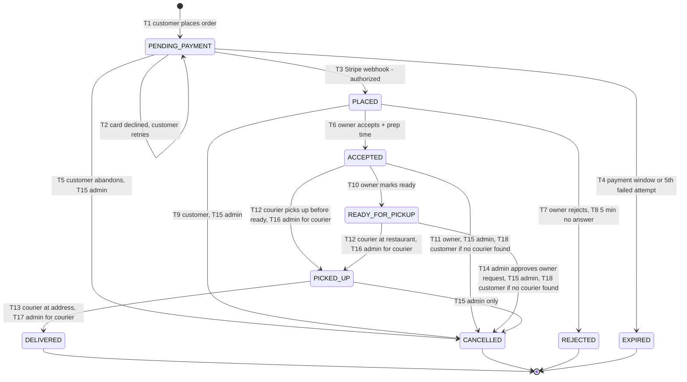
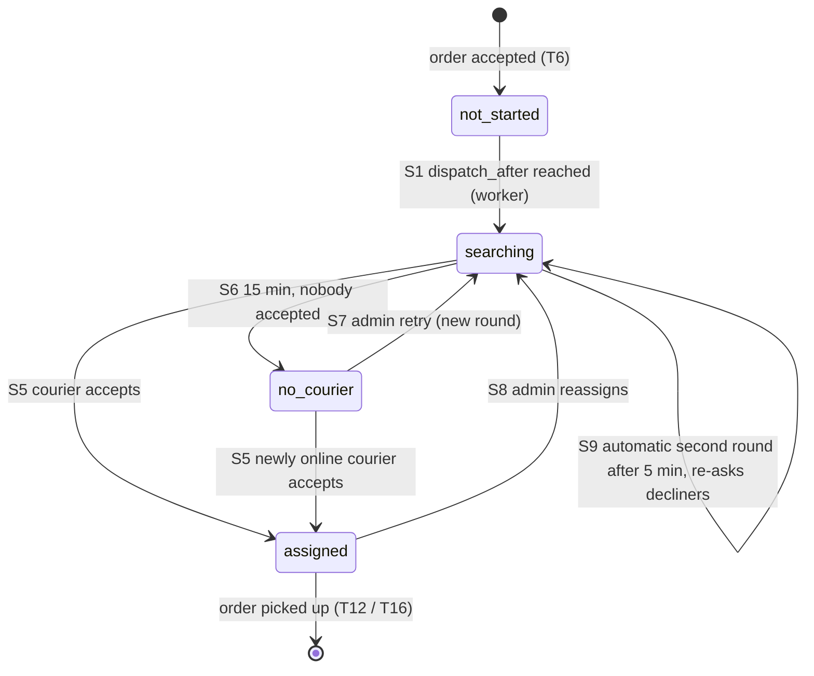

# BiteFetch – Order state machine

Regenerated on 2026-10-08 from the diagrams, plus the review decisions R1–R13.

| Source | Pages |
|---|---|
| `docs/design/diagrams/order-state-machine.drawio` | Order status, Dispatch |
| `docs/design/database/schema.dbml` | The schema (single source of truth; special SQL in `docs/design/database/constraints.sql`, notes in `docs/design/notes/schema-notes.md`) |
| `docs/design/diagrams/happy-path.drawio` | Happy path (messages M1–M37) |
| `docs/design/diagrams/unhappy-paths.drawio` | 1 Restaurant rejects · 2 Courier declines · 3 Offer times out · 4 Nobody accepts · 5 Customer cancels · 6 Payment fails or retried |
| `docs/design/diagrams/supporting-flows.drawio` | Account lifecycle, Signup → approval, Chat |

How to read the tags:

| Tag | Meaning |
|---|---|
| no tag | Taken from the diagrams |
| *(review Rn)* | Decided in review. See [§6.2](#62-decisions-added-in-review) |
| *(assumed nn)* | Not in the diagrams or the review; the most realistic option was chosen. See [§7](#7-assumptions--veto-any-of-these) and veto any you disagree with |

Rules that hold everywhere (from the diagrams):
- Each order arrow is one conditional `UPDATE … WHERE status = <from>`.
- Side effects (Stripe calls, socket events, emails) are written as **outbox** rows in the same transaction. Outbox workers run on any instance.
- Payment is authorized at checkout and captured only on `DELIVERED`, so every cancel is a **void**.
- Socket events carry `version`, and clients ignore older versions.
- Lock order is **user → order → offer**.
- All times use the database clock.

---

## 1. Statuses

### 1.1 Order status (`orders.status`)

| Status | Meaning | Entered by | Terminal |
|---|---|---|---|
| `PENDING_PAYMENT` | Waiting for card authorization | Customer places order (T1); unchanged on a declined card (T2) | No |
| `PLACED` | Paid (authorized), waiting for the restaurant | System: Stripe webhook or reconciliation sweeper (T3) | No |
| `ACCEPTED` | Preparing; prep time set | Restaurant owner (T6) | No |
| `READY_FOR_PICKUP` | Food at the counter | Restaurant owner (T10) | No |
| `PICKED_UP` | Courier has the food | Courier within 150 m (T12), or admin for the courier (T16) | No |
| `DELIVERED` | Delivered; payment captured | Courier within 150 m (T13), or admin for the courier (T17) | **Yes**. Nobody can cancel, capture is final, and complaints go through support chat *(review R9)* |
| `CANCELLED` | Authorization voided; `cancelled_by` and `cancel_reason` recorded | Customer (T5, T9, T18), owner (T11), admin (T14, T15) | **Yes** |
| `REJECTED` | Owner declined or didn't answer; authorization voided | Owner (T7), system (T8) | **Yes** |
| `EXPIRED` | Never paid; authorization voided | System: payment window or 5th failed attempt (T4) *(assumed 01)* | **Yes** |

### 1.2 Dispatch state (`orders.dispatch_state`)

Runs in parallel with the order status while `ACCEPTED` or `READY_FOR_PICKUP`.

| State | Meaning | Entered by | Terminal |
|---|---|---|---|
| `not_started` | Waiting for `dispatch_after` | Order accepted (T6) | No |
| `searching` | Offering one courier at a time | Worker (S1), admin retry (S7), admin reassign (S8), automatic second round (S9) *(assumed 10)* | No |
| `no_courier` | Admin alerted; still offers newly online couriers | Sweeper at `dispatch_deadline` (S6) | No |
| `assigned` | `orders.courier_id` set | Courier accepts (S5) | No. Dispatch ends when the order is picked up (T12/T16) |

Dispatch also ends when the order is cancelled or rejected. The pending offer is withdrawn and the courier released in the same transaction.

### 1.3 Offer status (`order_offers.status`)

| Status | Meaning | Entered by | Terminal |
|---|---|---|---|
| `pending` | `expires_at = offered_at + offer timeout` (30 s, from `platform_settings`) *(review R2)* | Dispatch (S2) | No |
| `accepted` | Courier is assigned | Courier accepts before `expires_at` (S5) | Yes |
| `declined` | Next courier is offered | Courier declines or goes offline (S3) | Yes |
| `expired` | Next courier is offered | Sweeper (S4) | Yes |
| `withdrawn` | No longer valid | Order cancelled or picked up, or admin reassigns (S8) | Yes |

### 1.4 Courier availability (`courier_profiles.availability`) *(review R10)*

| State | Meaning | Entered by |
|---|---|---|
| `online` | Can receive offers | Courier goes online. Requires a **fresh position** *(review R10)*, which means one under 30 s old, the same freshness rule as offers *(assumed 17)* |
| `offline` | No new offers | Courier goes offline (`offline_reason = manual`); 2 missed offers in a row (`missed_offers`, flow 3); no position for 2 min (`no_position`) *(review R10)*; suspended (`suspended`) *(review R10)* |

Going offline automatically never touches an active delivery. It only stops new offers *(assumed 17)*. Each courier has at most one active delivery (unique index).

### 1.5 Account status (`users.status`)

| Status | Meaning | Entered by | Terminal |
|---|---|---|---|
| `PENDING_ACTIVATION` | Email not verified yet | Sign up (A1) | No |
| `PENDING_APPROVAL` | Owner or courier waiting for admin | Owner or courier activates (A3); reapplies (A7) | No |
| `ACTIVE` | Full access for the role | Customer activates (A2); admin approves (A5) or reactivates (A9). The admin is seeded as `ACTIVE` | No |
| `REJECTED` | Can log in to see the reason or reapply | Admin (A6) | No |
| `SUSPENDED` | Cannot log in; sessions revoked; courier set offline | Admin (A8) | No |
| `DELETED` | PII anonymized; orders kept | User (A10), admin (A11) | **Yes** |
| *(purged)* | Row hard-deleted | Sweeper, not activated in 7 days (A4) | End |

### 1.6 Conversation status (`conversations.status`)

| Status | Meaning | Entered by | Terminal |
|---|---|---|---|
| `OPEN` | Active thread | Customer starts (C1) or writes after resolve (C4) | No |
| `RESOLVED` | Marked handled | Owner or admin (C3) | No |
| `CLOSED` | Read-only | Sweeper (C5) | **Yes** *(assumed 02)* |

### 1.7 Incidents (`order_incidents`)

None of these change the order status. All are deduplicated by `UNIQUE (order_id, type) WHERE resolved_at IS NULL`.

| Type | Opened when | Resolved when |
|---|---|---|
| `restaurant_unresponsive` | 2nd consecutive accept timeout; the restaurant is paused (flow 1) | Admin unpauses the restaurant *(assumed 16)* |
| `no_courier` | S6 | S5 assigns a courier, or the order is cancelled (flow 4) |
| `capture_failed` | 3 automatic capture retries failed (flow 6) | Capture succeeds (flow 6) |
| `kitchen_late` | Still `ACCEPTED` 10 min after `estimated_ready_at`. The owner is notified; no status changes *(review R4)* | T10, T12, T16 or any cancel *(assumed 16)* |
| `courier_problem` | Courier "Report a problem", with a `category` (`customer_unreachable`, `wrong_or_missing_items`, `vehicle_issue`, `restaurant_closed`, `other`) and a note *(review R5)* | The admin resolves it after acting, or the order reaches a terminal status *(assumed 16)* |
| `delivery_overdue` | `PICKED_UP` and `now() > estimated_delivery_at + 30 min`. No automatic transition *(review R7)* | T13, T17 or T15 *(assumed 16)* |

---

## 2. Transitions

### 2.1 Order transitions (T)

| # | From → To | Trigger | Guard (WHERE / checks) | Side effects | Concurrency |
|---|---|---|---|---|---|
| T1 | ∅ → `PENDING_PAYMENT` | Customer: `POST /api/orders`, header `Idempotency-Key` (M4) | Customer `ACTIVE`. Restaurant open and not paused; items available at this restaurant; address in range; fresh courier within 10 km. Subtotal ≥ minimum order (25 RON) *(review R2)*. Totals recomputed on the server in integer bani *(review R1)*. Delivery fee = 7 RON up to 3 km of OSRM route distance, +2 RON per started extra km *(review R2)*, using the route restaurant → delivery address at checkout *(assumed 21)* | Insert order with `order_code` (e.g. `BF-7K3Q9`) *(review R11, assumed 19)*, `subtotal`, `delivery_fee`, `total`, `currency = 'RON'` *(review R1)*, `delivery_address_snapshot`, `payment_expires_at = now() + payment window` (15 min) *(review R2, assumed 18)*. Create PaymentIntent (manual capture). `201 {orderId, orderCode, clientSecret}`. Client joins `order:{id}` | Same `Idempotency-Key`: conflict on `(customer_id, idempotency_key)` returns the same order and `clientSecret`; no second PaymentIntent |
| T2 | `PENDING_PAYMENT` → `PENDING_PAYMENT` | Stripe webhook `payment_intent.payment_failed` | `status = 'PENDING_PAYMENT'`; deduped by event id | `last_payment_error`, `payment_attempts + 1`. ⚡ `payment.failed {code, attemptsLeft}`. At the 5th failure → T4 | A failed webhook after success is a no-op. Duplicates are stopped by the `stripe_events` primary key |
| T3 | `PENDING_PAYMENT` → `PLACED` | Stripe webhook `payment_intent.amount_capturable_updated` (M7), or the reconciliation sweeper (after 2 min, when the PaymentIntent is `requires_capture`) | `status = 'PENDING_PAYMENT'`; deduped by event id; amount equals `total` | `payment_status = 'authorized'`, `placed_at`, `accept_deadline = now() + accept window` (5 min) *(review R2)*. ⚡ `order.new` to `restaurant:{id}`; `order.updated PLACED` to customer and admin | A late authorization after T4 or T5 matches 0 rows, so a compensating `payment.void` is queued with the same key. Webhook vs reconciliation: one transition |
| T4 | `PENDING_PAYMENT` → `EXPIRED` | Sweeper: payment window over; **or** the 5th failed attempt *(assumed 01)*; or reconciliation finds the PaymentIntent `canceled` | `status = 'PENDING_PAYMENT' AND (payment_expires_at <= now() OR payment_attempts >= 5)` | `cancel_reason = payment_window` or `too_many_attempts` *(assumed 01)*. Outbox `payment.void` (key `order:{id}:void`). ⚡ `order.updated EXPIRED` ("cart is saved") | vs success webhook: one wins; a late success gets a compensating void |
| T5 | `PENDING_PAYMENT` → `CANCELLED` | Customer: `POST /api/orders/:id/cancel` (Z1). The admin uses T15 | Lock order; `status = 'PENDING_PAYMENT' AND customer_id = $me` | `cancelled_by = customer`, `cancel_reason = abandoned_checkout` *(assumed 04)*. Outbox `payment.void`. Cart restored | vs webhook: the webhook queues a compensating void. vs expiry: `CANCELLED` or `EXPIRED`, one void |
| T6 | `PLACED` → `ACCEPTED` | Owner: `POST /api/restaurant/orders/:id/accept {prepMinutes}` (M11) | Owner `ACTIVE` (F8). `restaurant_id` = owner's restaurant. `status = 'PLACED' AND accept_deadline > now()`. `prepMinutes` ∈ 10–60 in steps of 5, default 20 *(review R3)* | `accepted_at`; `estimated_ready_at = accepted_at + prep`; `dispatch_after = max(accepted_at, estimated_ready_at − 10 min)` *(review R3)*; `dispatch_state = 'not_started'`. ⚡ `order.updated ACCEPTED` with ETA | Races T7, T8 and T9 on `status = 'PLACED'`. After the deadline: `409 {status: REJECTED}` |
| T7 | `PLACED` → `REJECTED` | Owner: `POST /api/restaurant/orders/:id/reject {reasonCode, note}` (U1) | Lock order; `restaurant_id` = owner's; `status = 'PLACED'`; reason ∈ `out_of_stock`, `too_busy`, `closing_soon`, `other` (with note) | `cancelled_by = restaurant`. Optionally mark ticked items unavailable in `restaurant_item_availability` (same transaction) *(review D1)*. Outbox void and events. ⚡ `order.updated REJECTED + reasonCode` | vs customer cancel: one wins, one void. Double tap: already `REJECTED` by the same restaurant, so 200 |
| T8 | `PLACED` → `REJECTED` | Sweeper | `status = 'PLACED' AND accept_deadline <= now()`, `FOR UPDATE SKIP LOCKED` | `cancelled_by = system`, `cancel_reason = restaurant_timeout`. `restaurants.consecutive_timeouts + 1`; at 2, `paused_until` is set and a `restaurant_unresponsive` incident opens. Outbox void. ⚡ missed-order notice to the restaurant | vs owner reject: ends `REJECTED` either way |
| T9 | `PLACED` → `CANCELLED` | Customer: `POST /api/orders/:id/cancel {reason}` (Z4). The admin uses T15 | Lock order; `status = 'PLACED' AND customer_id = $me` | `cancelled_by = customer`. Outbox void and events. ⚡ `order.updated CANCELLED` to restaurant and admin | vs accept: one wins; the loser gets 409 ("Chat with support") |
| T10 | `ACCEPTED` → `READY_FOR_PICKUP` | Owner: `POST /api/restaurant/orders/:id/ready` (M22) | Owner `ACTIVE`; `restaurant_id` = owner's; `status = 'ACCEPTED'` *(assumed 03)* | `ready_at = now()`. If `dispatch_after > now()`, set it to `now()` so dispatch starts right away *(assumed 03)*. Resolve an open `kitchen_late` incident *(assumed 16)*. ⚡ `order.updated READY_FOR_PICKUP` to courier and customer | vs T11 or T12 (both from `ACCEPTED`): one wins; the loser gets 409 *(assumed 03)* |
| T11 | `ACCEPTED` → `CANCELLED` | Owner: `POST /api/restaurant/orders/:id/cancel {reasonCode, note}` | Owner `ACTIVE`; `restaurant_id` = owner's; `status = 'ACCEPTED'` ("until marked ready", roles page); reason ∈ `out_of_stock`, `kitchen_issue`, `too_busy`, `other` (with note) *(assumed 04)* | `cancelled_by = restaurant`. Pending offer → `withdrawn`; `courier_id = NULL` if assigned. Outbox `payment.void`. ⚡ `order.updated CANCELLED` to customer, admin and the released courier; `offer.closed {reason: withdrawn}` to a courier with a pending offer *(assumed 04)* | Lock order first. vs T10, vs T12 from `ACCEPTED`, vs S5 accept: one wins *(assumed 04)* |
| T12 | `ACCEPTED` or `READY_FOR_PICKUP` → `PICKED_UP` | Courier: `POST /api/courier/orders/:id/pickup` (M25) | Courier `ACTIVE`; `courier_id = $me AND status IN ('ACCEPTED','READY_FOR_PICKUP')`; the last stored position is within 150 m of the restaurant (server-side) *(assumed 05)* | `picked_up_at`; `ready_at = coalesce(ready_at, now())`; `estimated_delivery_at` from the OSRM route. A pending cancel request → `superseded` *(assumed 06)*. Resolve `kitchen_late` *(assumed 16)*. Dispatch ends. `200 {route to customer}`. ⚡ `order.updated PICKED_UP` | Because the guard includes `courier_id = $me`, a reassigned courier gets 409. vs T11, T14 or T15: one wins. Double tap: 200 *(assumed 05)* |
| T13 | `PICKED_UP` → `DELIVERED` | Courier: `POST /api/courier/orders/:id/deliver` (M30) | `courier_id = $me AND status = 'PICKED_UP'`; within 150 m of the delivery address *(assumed 05)* | `delivered_at`; courier free again. Outbox `payment.capture`, key `order:{id}:capture:1`. Resolve `delivery_overdue` *(assumed 16)*. ⚡ `order.updated DELIVERED` | vs T15: one wins. Double tap: 200, one capture |
| T14 | `READY_FOR_PICKUP` → `CANCELLED` | Admin approves the owner's cancellation request | Request: owner `POST /api/restaurant/orders/:id/cancel-request {reasonCode, note}` while `READY_FOR_PICKUP`, one pending per order (unique index). Approval: `POST /api/admin/cancel-requests/:id/approve {version}`, with `status = 'READY_FOR_PICKUP' AND version = $seen` *(assumed 06)* | Request → `approved`. Order effects as T11 *(assumed 06)*. Reject: request → `rejected`, order unchanged | vs T12: if pickup wins, the request becomes `superseded` and the admin gets 409 *(assumed 06)* |
| T15 | Any non-terminal → `CANCELLED` (drawn from `PENDING_PAYMENT`, `PLACED`, `ACCEPTED`, `READY_FOR_PICKUP`, `PICKED_UP`) | Admin: `POST /api/admin/orders/:id/cancel {reason, version}` (Y10). After pickup, only the admin can cancel *(review R8)*. Exception path for R6 | `status NOT IN` terminal `AND version = $seen` | Withdraw the pending offer; release the courier; outbox `payment.void`, so the customer is never charged. Restaurant compensation is out of scope *(review R8)*. Resolve open incidents *(assumed 16)*. ⚡ `order.updated CANCELLED` to customer, restaurant and courier | Version check: vs courier accept, vs T13, or two admins, the loser gets 409 |
| T16 | `ACCEPTED` or `READY_FOR_PICKUP` → `PICKED_UP` | Admin for the courier: `POST /api/admin/orders/:id/mark-picked-up {reason, version}` *(assumed 07)* | `courier_id IS NOT NULL AND status IN ('ACCEPTED','READY_FOR_PICKUP') AND version = $seen`; reason required; no location check *(assumed 07)* | As T12; audit actor `admin:{id}` *(assumed 07)* | Version check vs the courier's own T12 *(assumed 07)* |
| T17 | `PICKED_UP` → `DELIVERED` | Admin for the courier: `POST /api/admin/orders/:id/mark-delivered {reason, version}` *(assumed 07)*. The **default** when the customer is unreachable at the door after the courier waited 10 min *(review R6)* | `status = 'PICKED_UP' AND version = $seen`; reason required *(assumed 07)*. For R6: an open `courier_problem` / `customer_unreachable` incident at least 10 min old *(assumed 22)* | As T13, including capture, because the food was prepared and delivered *(review R6)*. Resolve the incident | Version check vs the courier's own T13 *(assumed 07)* |
| T18 | `ACCEPTED` or `READY_FOR_PICKUP` → `CANCELLED` | Customer: `POST /api/orders/:id/cancel` while no courier is found (Y13, Z10) | Lock order; `status IN ('ACCEPTED','READY_FOR_PICKUP') AND dispatch_state = 'no_courier' AND courier_id IS NULL AND customer_id = $me` | `cancel_reason = no_courier`. Withdraw the pending offer; resolve the incident; outbox void. ⚡ `order.updated CANCELLED` to the restaurant; `offer.closed {offerId, reason: withdrawn}`; `incident.resolved` to admin | vs courier accept: the `courier_id IS NULL` guard means exactly one wins (409 "a courier just accepted") |

### 2.2 Dispatch transitions (S)

| # | From → To | Trigger | Guard (WHERE / checks) | Side effects | Concurrency |
|---|---|---|---|---|---|
| S1 | `not_started` → `searching` | Worker | `status IN ('ACCEPTED','READY_FOR_PICKUP') AND dispatch_state = 'not_started' AND dispatch_after <= now()`, `FOR UPDATE SKIP LOCKED` *(assumed 08)* | `dispatch_started_at = now()`, `dispatch_deadline = now() + 15 min`, `dispatch_round = 1`, then S2 in the same tick *(assumed 08)* | `SKIP LOCKED`, so each order is started once |
| S2 | `searching` (offer made) | Worker, a kick after a decline or expiry (2 s poll as fallback), or a kick when a courier becomes free | Lock order `FOR UPDATE SKIP LOCKED`; no pending offer. Candidate: online, idle, position under 30 s old, not asked this round, radius 3 → 6 → 10 km from the restaurant | Insert offer (`pending`, `expires_at = now() + offer timeout`) *(review R2)*. ⚡ `offer.created` to `courier:{id}`; `dispatch.updated` to admin. No candidate: `next_search_at = now() + backoff (2 → 5 → 10 → 30 s)` | Unique indexes: one pending offer per order, one per courier, `(order_id, round, courier_id)` |
| S3 | offer `pending` → `declined` | Courier: `POST /api/courier/offers/:offerId/decline {reason}`; or the courier goes offline | Lock order first; `id = $1 AND courier_id = $me AND status = 'pending'` | `decline_reason`, `responded_at`. `200`. Kick dispatch. `consecutive_missed_offers = 0` (any answer resets it) | Already declined by me: 200. Otherwise `409 {offerStatus}` |
| S4 | offer `pending` → `expired` | Sweeper | `status = 'pending' AND expires_at <= now()`, `ORDER BY expires_at LIMIT 100 FOR UPDATE SKIP LOCKED` | `responded_at`. ⚡ `offer.closed {offerId, reason: expired}`. `consecutive_missed_offers + 1`; at 2 → offline (`missed_offers`) and ⚡ `courier.availability {online: false}`. Then `dispatchOrder` per order, each in its own transaction | Locks only offers; the order is locked in a new transaction, so no deadlock |
| S5 | `searching` or `no_courier` → `assigned` | Courier: `POST /api/courier/offers/:offerId/accept` (M14) | Lock the courier's users row (must be `ACTIVE`) → lock the order → offer `WHERE status = 'pending' AND expires_at > now()` → order `WHERE courier_id IS NULL AND status IN ('ACCEPTED','READY_FOR_PICKUP')` | Offer `accepted`; `courier_id` set; `dispatch_state = 'assigned'`; `no_courier` incident resolved; `consecutive_missed_offers = 0`. `200 {order, route}`. ⚡ `order.updated` (courier assigned) | vs expiry: exactly one. A late accept gets `409 {expired}`. A second active delivery is blocked by the unique index |
| S6 | `searching` → `no_courier` | Sweeper | `dispatch_state = 'searching' AND courier_id IS NULL AND dispatch_deadline <= now()` | `version + 1`; incident `no_courier`. ⚡ `order.updated` to customer and restaurant; `incident.opened` to admin | Two sweepers: one transition, one incident |
| S7 | `no_courier` → `searching` | Admin: `POST /api/admin/orders/:id/retry-dispatch {version}` | `dispatch_state = 'no_courier' AND version = $seen` | `dispatch_round + 1`; `dispatch_deadline = now() + 15 min` | vs courier accept: the version check gives the admin a 409 |
| S8 | `assigned` → `searching` | Admin: `POST /api/admin/orders/:id/reassign-courier {reason, version}` *(assumed 09)*. Used for a `vehicle_issue` before pickup *(review R5)* | `dispatch_state = 'assigned' AND status IN ('ACCEPTED','READY_FOR_PICKUP') AND version = $seen` *(assumed 09)* | The old courier's offer → `withdrawn`; `courier_id = NULL`. The old courier stays excluded this round. ⚡ `order.updated` ("reassigned") to the old courier, customer and restaurant *(assumed 09)* | vs T12 by the old courier: one wins *(assumed 09)* |
| S9 | `searching` → `searching` (automatic second round) | Worker | `dispatch_state = 'searching' AND dispatch_round = 1 AND dispatch_started_at <= now() - 5 min` **and** no candidate left *(assumed 10)* | `dispatch_round = 2`. Re-asks couriers who **declined** in round 1, not those whose offers expired. **Does not** reset `dispatch_deadline` *(assumed 10)* | Conditional on `dispatch_round = 1`, so it runs at most once. vs S6: whichever runs first; S6 still fires at the original deadline *(assumed 10)* |

### 2.3 Account transitions (A)

Every A-transition is an `UPDATE users … WHERE status = <from>` in one transaction. A trigger writes `account_status_history`. Leaving `ACTIVE` revokes refresh tokens and disconnects sockets on every instance. Access tokens live up to 15 min, so state-changing endpoints re-check `users.status` in their own transaction.

| # | From → To | Trigger | Guard (WHERE / checks) | Side effects | Concurrency |
|---|---|---|---|---|---|
| A1 | ∅ → `PENDING_ACTIVATION` | `POST /api/auth/signup` (`/owner`, `/courier`). Role from the route | Unique `lower(email)`. Rate limit: 5 signups per hour per IP *(review R13)*. Owner: picks the matching OSM restaurant *(review D1)* | Owner or courier: `INSERT application (pending)`. Token hash; outbox `email.activation`. `202`, the same reply if the email exists | Same email twice: one row; the other gets the same 202 |
| A2 | `PENDING_ACTIVATION` → `ACTIVE` | Customer: `POST /api/auth/activate {token}` | Token `token_hash = $1 AND used_at IS NULL AND expires_at > now()`; user `status = 'PENDING_ACTIVATION'` | `200 {status}` with tokens | Double click: 0 rows, so the reply is the current status |
| A3 | `PENDING_ACTIVATION` → `PENDING_APPROVAL` | Owner or courier: same call | As A2 | ⚡ `application.new` to admin | As A2 |
| A4 | `PENDING_ACTIVATION` → *(purged)* | Sweeper | `status = 'PENDING_ACTIVATION' AND created_at <= now() - 7 days`, `SKIP LOCKED` *(assumed 11)* | Hard delete the user with their tokens and application (cascade) *(assumed 11)* | Two sweepers: `SKIP LOCKED` |
| A5 | `PENDING_APPROVAL` → `ACTIVE` | Admin: `POST /api/admin/applications/:id/approve {version}` | Application `status = 'pending' AND version = $seen`; user `status = 'PENDING_APPROVAL'` | Owner: the admin **confirms the OSM match** chosen at signup; the restaurant must have opening hours (`restaurants_owned_have_hours`). Independent → private one-restaurant brand edited by the owner; chain → admin-managed brand *(review D1, assumed 12)*. Courier: `courier_profiles` row (offline). ⚡ `account.updated ACTIVE` and email | Two admins: the loser gets 409 |
| A6 | `PENDING_APPROVAL` → `REJECTED` | Admin: `POST /api/admin/applications/:id/reject {reason, version}` | `status = 'pending' AND version = $seen` | Application `rejected` with the reason. ⚡ `account.updated REJECTED` and email | As A5 |
| A7 | `REJECTED` → `PENDING_APPROVAL` | User: `POST /api/me/application` (maximum 3 applications) | User `status = 'REJECTED'`; one pending application per user | New application row. ⚡ `application.new` | Unique pending application |
| A8 | `ACTIVE` → `SUSPENDED` | Admin: `POST /api/admin/users/:id/suspend {reason, version}` | `status = 'ACTIVE' AND version = $seen`; refused (409) while the courier has an active delivery | Revoke refresh tokens; courier offline (`suspended`) *(review R10)*. ⚡ `account.updated SUSPENDED`, then `disconnectSockets(user:{id})` | vs offer accept: user row lock; accept checks `ACTIVE` |
| A9 | `SUSPENDED` → `ACTIVE` | Admin: `POST /api/admin/users/:id/reactivate {reason, version}` *(assumed 13)* | `status = 'SUSPENDED' AND version = $seen` *(assumed 13)* | ⚡ `account.updated ACTIVE` and email. A courier stays offline until they go online with a fresh position *(review R10)* | Version check *(assumed 13)* |
| A10 | `ACTIVE`, `PENDING_APPROVAL` or `REJECTED` → `DELETED` | User: `DELETE /api/me` with the password | No non-terminal orders or deliveries | Anonymize PII; revoke tokens. `204`, or `409` | vs placing an order: user row lock; order insert checks `ACTIVE` |
| A11 | `SUSPENDED` → `DELETED` | Admin: `DELETE /api/admin/users/:id {reason, version}` *(assumed 13)* | `status = 'SUSPENDED' AND version = $seen`; no non-terminal orders or deliveries *(assumed 13)* | As A10 *(assumed 13)* | Version check *(assumed 13)* |

Password reset and password change don't change the status. A reset revokes all refresh tokens and increments `token_version`. Login is rate-limited to 5 per minute per IP and email; activation resend to 3 per hour per email *(review R13)*.

### 2.4 Conversation transitions (C)

| # | From → To | Trigger | Guard (WHERE / checks) | Side effects | Concurrency |
|---|---|---|---|---|---|
| C1 | ∅ → `OPEN` | Customer: `POST /api/orders/:id/conversation` or `POST /api/support/conversations` | Order chat: customer owns the order; order active or ended less than 24 h ago; `INSERT … ON CONFLICT DO NOTHING` on unique `order_id WHERE type = 'order'`. Support: one `OPEN` support chat per customer | `200 {conversationId, lastSeq}`. Room join after the participant check. The thread shows the `order_code` *(review R11)* | Two tabs: the same conversation |
| C2 | `OPEN` → `OPEN` (message) | Participant: `POST /api/conversations/:id/messages {clientMsgId, body}` | Not `CLOSED`; text only, at most 2000 chars; 30 messages per minute per user *(review R13)*. `UPDATE conversations SET last_seq = last_seq + 1 RETURNING`, then `INSERT message ON CONFLICT (conversation_id, client_msg_id) DO NOTHING` | `201 {message, seq}`. ⚡ `chat.message` to `conversation:{id}`, `restaurant:{id}` or `admin`. A staff reply unread after 10 min sends an email (at most 1 per conversation per hour) | Row lock gives gap-free seq. A retry returns the same message |
| C3 | `OPEN` → `RESOLVED` | Owner or admin: `POST /api/conversations/:id/resolve {seenSeq}` | `status = 'OPEN' AND last_seq = $seenSeq` | "Marked resolved" line. ⚡ `chat.updated RESOLVED` | A new message gives 409 |
| C4 | `RESOLVED` → `OPEN` | The customer writes (part of C2) | As C2 | As C2 | As C2 |
| C5 | `OPEN` or `RESOLVED` → `CLOSED` | Sweeper | Order chat: `type = 'order' AND status IN ('OPEN','RESOLVED')` and the order has been terminal for 24 h. Support chat: `type = 'support' AND status = 'RESOLVED' AND resolved_at <= now() - 7 days`. An `OPEN` support chat never auto-closes *(assumed 14)* | ⚡ `chat.updated CLOSED`; read-only *(assumed 14)* | vs C2: both lock the conversation; a send to `CLOSED` gets 409 |

### 2.5 Payment status (`orders.payment_status`)

Values: `pending | authorized | voided | captured | capture_failed`.

| From → To | Trigger | Guard | Side effects |
|---|---|---|---|
| `pending` → `authorized` | T3 | as T3 | as T3 |
| `pending` or `authorized` → `voided` | T4, T5, T7, T8, T9, T11, T14, T15, T18, after Stripe confirms | — | `paymentIntents.cancel`, key `order:{id}:void`, retried with backoff; "already canceled" counts as success |
| `authorized` → `captured` | After T13 / T17 | — | `paymentIntents.capture`, key `order:{id}:capture:1` |
| `authorized` → `capture_failed` | 3 automatic retries fail (keys `:2`, `:3`) | — | Incident `capture_failed`; the order stays `DELIVERED` |
| `capture_failed` → `captured` | Admin: `POST /api/admin/orders/:id/retry-capture {version}` | `payment_status = 'capture_failed' AND version = $seen` | Next attempt key (`:4`, …); incident resolved |

Refunds are out of scope *(review R9)*.

---

## 3. Forbidden or impossible transitions worth testing

Anything not drawn is forbidden. Each must be rejected (409 or 403) and leave every row unchanged.

**Order status**
1. Any transition out of `DELIVERED` (no cancel, no refund) *(review R9)*, `CANCELLED`, `REJECTED` or `EXPIRED`.
2. `PENDING_PAYMENT` → anything but `PLACED`, `EXPIRED`, `CANCELLED` (or the T2 self-loop).
3. `PLACED` → `READY_FOR_PICKUP`, `PICKED_UP` or `DELIVERED`.
4. Backwards: `READY_FOR_PICKUP` → `ACCEPTED`; `PICKED_UP` → `READY_FOR_PICKUP`/`ACCEPTED`; `DELIVERED` → `PICKED_UP`.
5. `ACCEPTED`/`READY_FOR_PICKUP` → `DELIVERED` without `PICKED_UP`.
6. Customer cancel from `ACCEPTED`/`READY_FOR_PICKUP` unless T18's guard holds; customer or owner cancel after pickup (admin only) *(review R8)*.
7. Owner reject from anything but `PLACED`; owner direct cancel from `READY_FOR_PICKUP` (only a T14 request).
8. Accept after `accept_deadline`; `prepMinutes` outside 10–60 or not a multiple of 5 *(review R3)*.
9. Pickup or delivery by a courier outside 150 m, or by a courier who isn't `courier_id`.
10. T1 when any guard fails: restaurant closed or paused, item unavailable at this restaurant, address out of range, no fresh courier within 10 km, subtotal under 25 RON *(review R2)*. Client-sent prices or totals are ignored *(review R1)*.
11. A second order with the same `(customer_id, idempotency_key)`; two orders with the same `order_code` *(review R11)*.

**Dispatch, offers and couriers**

12. A second pending offer per order or per courier; the same courier twice in one round.
13. A second active delivery for one courier.
14. Accepting an expired, withdrawn or answered offer; accepting while the courier's user isn't `ACTIVE`.
15. `assigned` → `no_courier`; any dispatch change after pickup; S9 a second time *(assumed 10)*.
16. Going online without a fresh position *(review R10)*; offers to a courier whose position is older than 30 s.
17. An incident (`kitchen_late`, `courier_problem`, `delivery_overdue`) changing the order status *(review R4, R5, R7)*.

**Accounts**

18. Any transition out of `DELETED`; login while `PENDING_ACTIVATION` or `SUSPENDED`.
19. `PENDING_APPROVAL` → `ACTIVE` without admin approval; a customer in `PENDING_APPROVAL`; creating an admin through signup.
20. A8 while the courier has an active delivery; A10/A11 with non-terminal orders; a 4th application.
21. Exceeding the rate limits returns 429: login 5/min per IP + email, signup 5/h per IP, resend 3/h per email *(review R13)*.

**Chat**

22. Sending to `CLOSED`; resolving with a stale `seenSeq`; more than 30 messages per minute *(review R13)*.
23. A courier starting, joining or reading any chat; joining `conversation:{id}` as a non-participant.

---

## 4. Race conditions – test checklist

**From the diagrams**

Flow 1 – restaurant rejects
- [ ] Reject vs customer cancel: one wins; one void row.
- [ ] Reject vs accept on two devices: one wins; the other device gets 409.
- [ ] Owner reject vs sweeper: ends `REJECTED` either way.
- [ ] Double tap or retry: 200, one history row.
- [ ] Crash after COMMIT: the outbox row is still sent by another instance.
- [ ] Stripe down: the void is retried with the same key; "already canceled" counts as success.

Flow 2 – courier declines
- [ ] Decline vs 30 s expiry sweep: one outcome.
- [ ] Decline vs order cancelled: the decline gets 409.
- [ ] Decline vs accept on two devices: one wins.
- [ ] Kick vs worker tick for the same order: one new offer.
- [ ] Two orders pick the same courier: the loser takes its next courier.
- [ ] Instance dies after COMMIT, before the kick: the poll offers within 2 s.

Flow 3 – offer times out
- [ ] Accept vs expiry at the boundary: exactly one.
- [ ] Decline vs expiry: one outcome.
- [ ] Two sweepers: each offer expired once.
- [ ] No deadlock between the expiry transaction and dispatch.
- [ ] Restart: overdue offers are expired by the first sweep.
- [ ] The database clock decides, not an instance clock.

Flow 4 – nobody accepts
- [ ] S6 vs late accept: the accept works in either state.
- [ ] Admin retry or cancel vs courier accept: the admin gets 409.
- [ ] T18 vs courier accept: exactly one.
- [ ] Two admins: one action.
- [ ] Two sweepers: one transition, one incident.
- [ ] Restart: the deadline and backoff survive.

Flow 5 – customer cancels
- [ ] Cancel vs restaurant accept: the loser gets 409.
- [ ] Cancel vs accept-deadline sweeper: one terminal status, one void.
- [ ] Cancel vs authorization webhook: compensating void.
- [ ] Cancel vs payment-expiry sweeper: one void.
- [ ] T18 vs courier accept: one wins.
- [ ] Double tap: 200.

Flow 6 – payment fails or is retried
- [ ] Success webhook vs expiry sweeper: compensating void if the webhook is late.
- [ ] Failed webhook after success: no-op.
- [ ] Duplicate webhooks: handled once.
- [ ] Webhook vs reconciliation: one T3.
- [ ] Double Pay click: one confirmation.
- [ ] A deliberate retry uses a new idempotency key (`:2`, `:3`).
- [ ] Any instance can take any webhook.

Dispatch page
- [ ] Lock order user → order → offer is used everywhere; no 40P01 deadlock under mixed load.
- [ ] Accept by a courier who isn't `ACTIVE` is refused.

Accounts
- [ ] Double activation click: one transition.
- [ ] Two signups with the same email: one row.
- [ ] Two admins approve or reject: one wins.
- [ ] Suspend vs courier accept: the user row lock decides.
- [ ] Delete vs placing an order: the user row lock decides.

Chat
- [ ] Two messages at once: gap-free seq.
- [ ] Retry or double send: one message.
- [ ] Two tabs start the same order chat: one conversation.
- [ ] Resolve vs a new message: 409.
- [ ] Late read receipt: never goes backwards.
- [ ] Recipient on another instance: delivered, with gaps healed.

**Added by review decisions and assumptions**
- [ ] T10 vs T11 vs T12 (all from `ACCEPTED`): exactly one wins *(assumed 03, 04)*.
- [ ] T14 approval vs T12 pickup: if pickup wins, the request becomes `superseded` and the admin gets 409 *(assumed 06)*.
- [ ] T16/T17 (admin) vs the courier's own T12/T13: version check, one wins *(assumed 07)*.
- [ ] S8 reassign vs the old courier's pickup: one wins; the old courier gets 409 afterwards *(assumed 09)*.
- [ ] S9 vs S6 near the deadline: S9 runs at most once, and S6 still fires at the original deadline *(assumed 10)*.
- [ ] `kitchen_late` sweeper vs T10: if ready wins, no incident opens; if the incident wins, T10 resolves it. Never two open incidents *(review R4, assumed 16)*.
- [ ] `delivery_overdue` sweeper vs T13: same pattern *(review R7, assumed 16)*.
- [ ] No-position auto-offline vs offer accept: an offer accepted before the auto-offline still stands; afterwards no new offers *(review R10, assumed 17)*.
- [ ] `order_code` collision on insert: retried with a new code, the order is created once *(assumed 19)*.
- [ ] Changing `platform_settings` while orders are in flight: existing deadlines don't move *(assumed 18)*.
- [ ] Rate limits hold across 3 instances: the 6th login per minute gets 429 on any instance *(review R13, assumed 20)*.

---

## 5. Diagrams (Mermaid)

To import into draw.io: **Arrange → Insert → Advanced → Mermaid**.

### Order status

### Dispatch (`orders.dispatch_state`)

S9 is an assumption (assumed 10) and isn't drawn on the Dispatch page yet.

---

## 6. Decisions

### 6.1 Earlier decisions

| # | Decision |
|---|---|
| D1 | Every restaurant belongs to a brand. Independents get a private one-restaurant brand edited by their owner; chain brands are admin-managed. Availability is stored per restaurant (`restaurant_item_availability`). The owner picks the OSM match at signup, and the admin confirms it on approval. |
| D2 | The courier app reports its own position. Demos use a courier-simulator script. |
| D3 | Flow 6: expire after 5 failed attempts; reconciliation sweeper after 2 min; three automatic capture retries, then an incident and an admin retry. |

Flow decisions (shown in bold on each page's note):

| Flow | Q | Decision |
|---|---|---|
| 1 Restaurant rejects | Q1 | Restore the cart |
| | Q2 | Friendly text from the reason code |
| | Q3 | `out_of_stock`: tick items to disable |
| | Q4 | Auto-pause after 2 timeouts, plus an incident |
| | Q5 | Accept after the deadline is refused (409) |
| 2 Courier declines | Q1 | Kick after commit, with the poll as fallback |
| | Q2 | Optional decline reason |
| | Q3 | No penalty; decline rate shown to the admin |
| | Q4 | The customer only sees "finding a courier" |
| 3 Offer times out | Q1 | The app shows 25 s; the server allows 30 s |
| | Q2 | Offline after 2 missed offers in a row |
| | Q3 | Offers only to couriers with a position under 30 s old |
| | Q4 | Fixed 30 s (now a platform setting, R2) |
| 4 Nobody accepts | Q1 | The customer may cancel while `no_courier` (T18) |
| | Q2 | One automatic re-ask round after 5 min (S9) |
| | Q3 | Block checkout with no fresh courier within 10 km |
| | Q4 | Backoff, plus a kick when a courier becomes free |
| 5 Customer cancels | Q1 | Confirm dialog with an optional reason |
| | Q2 | Cart restored |
| | Q3 | After the cutoff: "Chat with support", pre-filled with the order |
| 6 Payment fails | Q1–Q3 | As D3 |
| Accounts | Q1 | Same 202, plus a "you already have an account" email |
| | Q2 | Reapply: edit and resubmit, one pending, maximum 3 |
| | Q3 | Superseded by D1 (assumed 12) |
| | Q4 | 15-min JWT plus rotating refresh tokens in the DB |
| | Q5 | Soft delete plus anonymization; orders kept |
| | Q6 | Purge unactivated accounts after 7 days |
| | Q7 | Refuse suspending a courier mid-delivery |
| Chat | Q1 | Active order plus 24 h, then read-only |
| | Q2 | Reopen the same thread |
| | Q3 | HTTP POST plus socket fan-out |
| | Q4 | Email if a reply is unread for 10 min |
| | Q5 | Admin reads order chats read-only, audited |
| | Q6 | Text only, at most 2000 characters |
| | Q7 | Emit after commit, plus seq gap fill |

### 6.2 Decisions added in review

| # | Decision | Where it applies |
|---|---|---|
| R1 | Money is stored in integer minor units (bani), with a `currency` column defaulting to `RON`. Totals are always recomputed on the server. | T1; `orders.subtotal`, `delivery_fee`, `total`, `currency` |
| R2 | `platform_settings` (key, value, updated_by), admin-editable: minimum order 25 RON; delivery fee 7 RON up to 3 km of route distance, +2 RON per extra km, rounded up; offer timeout 30 s; accept window 5 min; payment window 15 min. | T1, T3, S2, `order_offers.expires_at` |
| R3 | Prep time 10–60 min in 5-min steps (default 20). `estimated_ready_at = accepted_at + prep`. `dispatch_after = max(accepted_at, estimated_ready_at − 10 min)`. | T6 |
| R4 | `kitchen_late`: one incident when still `ACCEPTED` 10 min after `estimated_ready_at`. The owner is notified; no status changes. The admin may cancel (T15) or wait. | §1.7 |
| R5 | Courier "Report a problem" creates `courier_problem` with a category (`customer_unreachable`, `wrong_or_missing_items`, `vehicle_issue`, `restaurant_closed`, `other`) and a note. It never changes the order status. A `vehicle_issue` before pickup: the admin reassigns (S8). | §1.7, S8 |
| R6 | Customer unreachable at the door: the courier waits 10 min, then the admin decides. Default: T17 and capture. Exception: T15. | T17, T15 |
| R7 | `delivery_overdue` when `PICKED_UP` and `now() > estimated_delivery_at + 30 min`. No automatic transition. | §1.7 |
| R8 | Cancel after pickup: admin only (T15). The authorization is voided, so the customer isn't charged. Restaurant compensation is out of scope. | T15 |
| R9 | After `DELIVERED` nobody can cancel; capture is final; complaints go through support chat; refunds are out of scope. | §1.1, §2.5 |
| R10 | Courier set offline automatically after 2 min without a position, or when suspended. Going online needs a fresh position. One active delivery per courier. | §1.4, A8, A9 |
| R11 | Every order has a unique display code (e.g. `BF-7K3Q9`), separate from `id`, used in chat, receipts and incidents. | T1, C1, `orders.order_code` |
| R12 | Retention: processed outbox rows deleted after 7 days; `stripe_events` after 30 days; `order_status_history` partitioned monthly and kept 12 months; `order_offers` kept 12 months by batch delete (not partitioned, so its global partial uniques keep working – decided after the schema review); `courier_positions` keeps only the latest row per courier; refresh tokens purged 30 days after expiry. | Data model |
| R13 | Rate limits: login 5/min per IP + email; signup 5/h per IP; activation resend 3/h per email; chat 30 messages/min per user. | A1, C2, §3 |

---

## 7. Assumptions – veto any of these

| # | Assumption | Why this option |
|---|---|---|
| 01 | The 5th failed payment attempt is a second trigger of **T4** (`cancel_reason = too_many_attempts`), not a new T-number. | Same from/to and side effects as the payment-window expiry |
| 02 | Conversation `CLOSED` is terminal. | Read-only history; a new problem starts a new conversation |
| 03 | T10 requires the owner's restaurant and `status = 'ACCEPTED'`. Marking ready early pulls `dispatch_after` to `now()`. T10 races T11 and T12 on `ACCEPTED`. | The food is ready, so dispatch should start immediately |
| 04 | T11 reason codes: `out_of_stock`, `kitchen_issue`, `too_busy`, `other` (with note). Same release, void and event pattern as the other cancels. T5's reason is `abandoned_checkout`. | Mirrors T7 and the other cancels |
| 05 | T12/T13 guard: `courier_id = $me`, the expected status, and the 150 m check against the server-stored position. Double taps return 200. | Stops a reassigned courier; idempotent like every other transition |
| 06 | T14 uses `order_cancel_requests`: the owner requests while `READY_FOR_PICKUP` (one pending per order). The admin approves with a version check; effects as T11. Pickup marks a pending request `superseded`. | Matches the existing schema table and its status values |
| 07 | T16/T17 are admin endpoints with a required reason and version check, no location check, and the audit actor `admin:{id}`. Effects as T12/T13 (T17 captures). | The admin acts when the courier can't; audit shows who |
| 08 | S1 sets `dispatch_started_at`, `dispatch_deadline = +15 min` and `dispatch_round = 1`, then runs S2 in the same tick. | The columns exist and S6 needs the deadline |
| 09 | S8: admin endpoint with reason and version. The old courier's offer is `withdrawn` and they stay excluded this round. Events go to the old courier, customer and restaurant. Races the old courier's T12. | Same pattern as S7 |
| 10 | **S9** (next free number): automatic `searching → searching`, only from round 1, when nobody is left and 5 min have passed since dispatch started. It re-asks decliners only and doesn't reset `dispatch_deadline`. | Matches flow 4's "5 min since the round started", which falls inside the 15-min window. **This resolves the earlier F1 question; S9 is not drawn on the Dispatch page until you confirm** |
| 11 | A4 purge: `status = 'PENDING_ACTIVATION' AND created_at <= now() - 7 days`; cascade deletes tokens and the application. | Frees the email; nothing else references the user |
| 12 | A5 follows D1: the admin confirms the OSM match chosen at signup; independents get a private brand, chains link to an admin-managed brand. This supersedes account Q3 ("link existing or create"). | D1 is the later decision. **The Signup → approval page still shows the old wording** |
| 13 | A9 and A11 are admin endpoints with reason and version. A11 has the same no-active-orders guard and anonymization as A10. A reactivated courier stays offline. | Mirrors A8 and A10 |
| 14 | C5 closes order chats 24 h after the order is terminal, and support chats 7 days after `RESOLVED`. An `OPEN` support chat never auto-closes. | Never close a chat with an unanswered customer message |
| 15 | ~~Column types~~ – superseded: types are defined in `docs/design/database/schema.dbml` (money as `*_minor` integer columns, see schema-notes S1). | – |
| 16 | Incidents resolve themselves when the order moves past the problem (see §1.7). Otherwise the admin resolves them. `kitchen_late` is also sent to the owner as ⚡ `incident.opened` on `restaurant:{id}`. | Avoids stale open incidents and duplicates |
| 17 | "Fresh position" means under 30 s old, the same as for offers. The no-position auto-offline (R10) never affects an active delivery; it only stops new offers. `offline_reason` ∈ `manual`, `missed_offers`, `no_position`, `suspended`. | A tunnel or bad signal mid-delivery must not abandon the order |
| 18 | `platform_settings` values are read when a deadline or fee is set and copied into the order or offer row. Changing a setting never moves existing deadlines. | Predictable behaviour for in-flight orders |
| 19 | `order_code` = `BF-` + 5 random characters from Crockford base32 (no I, L, O, U); on a unique violation, retry with a new code. | Short, readable on the phone, and no ambiguous characters |
| 20 | Per-IP rate limits use Nginx `limit_req`. Per-email and per-user limits use Postgres counters until Redis arrives (Phase 5), then Redis. The response is 429 with `Retry-After`. | Must be shared across instances |
| 21 | The delivery fee uses the OSRM route distance restaurant → delivery address, computed once at checkout and stored on the order. | R2 says route distance; the total must not change after payment |
| 22 | For R6, the courier reports `courier_problem` / `customer_unreachable` at the door. The admin's T17 is allowed once that incident is at least 10 min old. | Puts R6's 10-min wait into the data the admin sees |

---

## 8. Data retention and limits *(review R12, R13)*

| Data | Rule |
|---|---|
| `outbox` | Processed rows deleted after 7 days |
| `stripe_events` | Deleted after 30 days |
| `order_offers`, `order_status_history` | Partitioned monthly; partitions kept 12 months |
| `courier_positions` | Only the latest row per courier |
| `refresh_tokens` | Purged 30 days after expiry |

| Limit | Value |
|---|---|
| Login | 5/min per IP + email |
| Signup | 5/h per IP |
| Activation resend | 3/h per email |
| Chat messages | 30/min per user |
